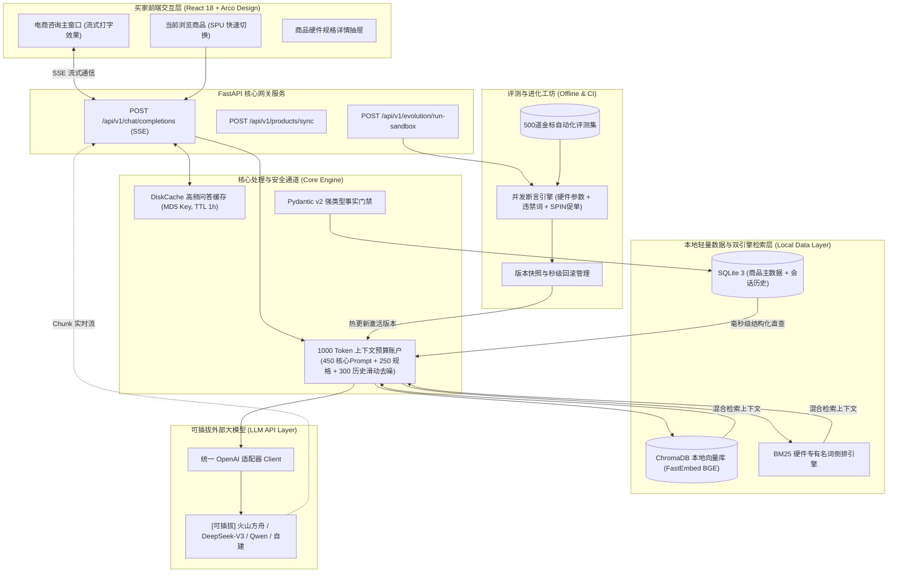

# 3C 电商纯文本智能客服与自进化评测系统
## 完整开发需求与技术落地规范文档 (PRD & Technical Specification)

> **版本**：v2.0.0 (轻量开源自进化版)  
> **核心架构定位**：纯文本 3C 数码电商顾问客服 + 本地轻量开源组件栈 + 可插拔 LLM API + Pydantic v2 强类型防幻觉 + 离线进化工坊与金标沙箱  
> **核心原则**：除大模型 (LLM) 推理采用标准 API（火山方舟/DeepSeek/OpenAI 兼容接口随时无缝切换）外，其余存储、检索、缓存、断言评测全部采用**本地轻量开源服务**，零云端额外账单，开箱即用。

---

## 目录
1. [项目背景与重构目标](#1-项目背景与重构目标)
2. [技术选型全景矩阵 (开源本地化)](#2-技术选型全景矩阵-开源本地化)
3. [系统总体架构与数据流](#3-系统总体架构与数据流)
4. [双轨事实注入与 Pydantic v2 规格防幻觉模型](#4-双轨事实注入与-pydantic-v2-规格防幻觉模型)
5. [本地轻量双引擎检索系统 (BM25 + ChromaDB)](#5-本地轻量双引擎检索系统-bm25--chromadb)
6. [运行时 1000 Token 上下文预算账户与本地缓存](#6-运行时-1000-token-上下文预算账户与本地缓存)
7. [可插拔统一 LLM 驱动层设计](#7-可插拔统一-llm-驱动层设计)
8. [离线进化工坊与 500 道金标自动化评测沙箱](#8-离线进化工坊与-500-道金标自动化评测沙箱)
9. [FastAPI 后端接口规范 (RESTful & SSE)](#9-fastapi-后端接口规范-restful--sse)
10. [前端 Web 客服界面改造规范 (React + Arco)](#10-前端-web-客服界面改造规范-react--arco)
11. [项目工程目录规范与分阶段落地计划](#11-项目工程目录规范与分阶段落地计划)

---

## 1. 项目背景与重构目标

### 1.1 背景与现状
原项目为火山引擎 AIGC-RTC 实时音视频 Demo，包含了推拉流、ASR（语音识别）、TTS（语音合成）、数字人渲染等复杂的音视频链路。但在 3C 数码电商售前咨询业务中，客户的核心诉求是**参数真实、解答专业、促单转化高、极速打字响应**。原 RTC 链路运维繁重且存在公网依赖，难以在低门槛开发环境中快速迭代演化。

### 1.2 重构核心目标
1. **纯文本极速交互**：彻底剥离 RTC、ASR、TTS 与数字人模块，全链路基于 **HTTP + Server-Sent Events (SSE)** 实现毫秒级首字打字机流式响应。
2. **全栈开源本地化（除 LLM 外）**：
   * 向量数据库、嵌入模型（Embedding）、结构化规格库、KV 缓存全部切换为本地轻量开源组件。
   * 单机（甚至无 GPU 普通笔记本）即可一键安装并秒级拉起全部服务。
3. **LLM API 极度解耦**：
   * 采用统一的 OpenAI 协议抽象层。当前接入火山方舟 Ark（Doubao），未来仅需修改 `.env` 中的 `BASE_URL`、`API_KEY` 和 `MODEL_NAME`，即可无缝切换为 DeepSeek、Qwen、Claude 或自建 Ollama，业务代码 0 修改。
4. **参数零幻觉 (< 0.5%)**：
   * 显卡满血功耗 (TGP)、M.2 接口数量、雷电协议、屏幕色域等核心参数，经 Pydantic 校验后从结构化数据库直接注入，杜绝模型凭空捏造。
5. **金标沙箱与自进化能力**：
   * 包含 500 道涵盖硬件断言、平台风控、SPIN 销售推进的自动化测试集，结合离线 Critic-Optimizer，实现客服 Prompt 的安全迭代与秒级回滚。

---

## 2. 技术选型全景矩阵 (开源本地化)

| 架构层级 | 原 Demo / 云服务方案 | 本次重构选型 (开源本地化) | 选型理由与技术优势 |
| :--- | :--- | :--- | :--- |
| **大模型 API** | 火山方舟 (硬编码) | **统一 OpenAI 兼容适配层** (默认方舟/可切 DeepSeek) | 接口标准化；支持流式推理与 Usage 统计，随时可插拔更换供应商。 |
| **向量数据库** | 火山知识库云 API (`air`) | **ChromaDB (本地嵌入式)** | 纯 Python 原生无外部守护进程，持久化至本地文件，零运维，支持元数据过滤。 |
| **本地 Embedding** | 云端 Embedding 接口 | **FastEmbed (`bge-small-zh-v1.5`)** | 智源中文优质小模型，基于 ONNX Runtime 在本地 CPU 毫秒级推理，0 API 费用。 |
| **倒排检索 (关键词)**| 无 (纯语义召回差) | **Rank-BM25 (纯 Python)** | 针对 3C 专有名词（如“i7-14700HX”、“RTX 4060”）进行 100% 精确字符定位。 |
| **商品规格库** | 云端关系库 | **SQLite 3 + JSON1 (或本地 PostgreSQL)** | 内置免安装，支持 JSON 查询；开发环境即拷即用，生产可平滑换 PG。 |
| **缓存与预算管理** | 云端 Redis | **DiskCache (本地磁盘与内存缓存)** | 线程/进程安全，原生支持 TTL 与 LRU，无需在系统额外安装 Redis 服务。 |
| **通信协议** | WebRTC 媒体流 | **HTTP POST + SSE (text/event-stream)** | 行业标准流式协议，抗网络抖动，轻量高效，跨端兼容性 100%。 |
| **前端交互** | 复杂会议/数字人 UI | **React 18 + Arco Design (电商客服专版)** | 复用现有项目 UI 库，改造为专业电商买家端 + SPU 规格抽屉 + 评测看板。 |

---

## 3. 系统总体架构与数据流



---

## 4. 双轨事实注入与 Pydantic v2 规格防幻觉模型

### 4.1 双轨事实注入原理
传统 RAG 在 3C 领域的致命缺陷是把参数文档切片后当成普通文本检索，模型经常看错行（把 A 笔记本的满血 140W 当成 B 笔记本的 105W）。
**双轨制方案**：
1. **轨 A（硬核事实 - 绝对优先）**：买家当前咨询的商品 SPU 编码（如 `HP-OMEN-16`），直接走 SQLite/PostgreSQL 结构化查询，通过 Pydantic 模型格式化为**绝对不可违背的硬性事实**；
2. **轨 B（软性知识 - 辅助检索）**：针对买家提出的发货、售后保障、促销礼品等开放式问题，走本地 ChromaDB + BM25 检索。

### 4.2 Pydantic v2 规格模型规范 (`backend/core/models/product_specs.py`)
```python
from typing import Optional, List
from pydantic import BaseModel, Field, field_validator

class DisplaySpec(BaseModel):
    screen_size: float = Field(..., description="屏幕尺寸(英寸)", ge=12.0, le=20.0)
    resolution: str = Field(..., description="分辨率，如 2.5K (2560x1600)")
    refresh_rate: int = Field(..., description="屏幕刷新率(Hz)", ge=60, le=500)
    color_gamut: str = Field(..., description="色域覆盖，如 100% sRGB")
    brightness_nits: Optional[int] = Field(None, description="亮度(nits)")

class HardwareSpec(BaseModel):
    cpu: str = Field(..., min_length=2, description="处理器型号，如 i7-14700HX")
    gpu: str = Field(..., min_length=2, description="显卡型号，如 RTX 4060")
    tgp_watt: int = Field(..., description="显卡功耗释放(W)", ge=35, le=200)
    ram_installed: str = Field(..., description="标配内存，如 16G DDR5 5600MHz")
    ram_slots: int = Field(..., description="内存插槽总数", ge=1, le=4)
    ram_max_gb: int = Field(..., description="最大支持内存容量(GB)", ge=16, le=128)
    storage_installed: str = Field(..., description="标配固态，如 1TB PCIe 4.0 NVMe")
    m2_slots_total: int = Field(..., description="M.2 固态插槽总数", ge=1, le=4)
    thunderbolt_port: bool = Field(False, description="是否支持雷电4/USB4")
    weight_kg: float = Field(..., description="整机重量(kg)", ge=0.8, le=6.0)

    @field_validator("tgp_watt")
    @classmethod
    def validate_tgp(cls, v: int) -> int:
        if v < 35 or v > 200:
            raise ValueError(f"异常的显卡释放功耗数值: {v}W")
        return v

class ProductItem(BaseModel):
    spu_code: str = Field(..., description="唯一 SPU 编码")
    title: str = Field(..., description="商品完整标题")
    brand: str = Field("HP", description="品牌")
    category: str = Field("游戏笔记本", description="品类")
    official_price: float = Field(..., description="官方指导价")
    display: DisplaySpec
    hardware: HardwareSpec
    sales_pitch: List[str] = Field(default_factory=list, description="推荐销售切入点 (FAB)")
    gift_policy: str = Field("晒单赠电竞双肩包+有线鼠标", description="当前促销赠品")

    def to_anchor_fact(self) -> str:
        """生成不可颠覆的 System Prompt 规格锚定块"""
        return (
            f"【咨询商品规格事实（绝对权威，严禁擅自修改参数）】\n"
            f"- 商品名称: {self.title} (SPU: {self.spu_code})\n"
            f"- 官方售价: ¥{self.official_price}\n"
            f"- 核心配置: CPU={self.hardware.cpu} | 显卡={self.hardware.gpu} ({self.hardware.tgp_watt}W 满血释放)\n"
            f"- 屏幕素质: {self.display.screen_size}英寸 | {self.display.resolution} | {self.display.refresh_rate}Hz | {self.display.color_gamut}\n"
            f"- 扩展性: 内存槽位={self.hardware.ram_slots}个(最大支持{self.hardware.ram_max_gb}G) | M.2固态插槽={self.hardware.m2_slots_total}个\n"
            f"- 接口与重量: 雷电4={ '支持' if self.hardware.thunderbolt_port else '不支持' } | 重量={self.hardware.weight_kg}kg\n"
            f"- 赠品政策: {self.gift_policy}\n"
        )
```

---

## 5. 本地轻量双引擎检索系统 (BM25 + ChromaDB)

针对通用售后政策、常见 Q&A、故障排除指南，搭建本地零云端依赖的混合检索。

### 5.1 架构实现规范
1. **向量检索器 (`LocalChromaRetriever`)**：
   * 依赖：`chromadb` + `fastembed`。
   * 模型：`BAAI/bge-small-zh-v1.5`（本地下载约 90MB ONNX 权重，CPU 单次计算 < 10ms）。
   * 本地持久化路径：`./data/chroma_db`。
2. **关键词检索器 (`LocalBM25Retriever`)**：
   * 依赖：`rank_bm25` + `jieba`（中文分词）。
   * 优势：针对硬件型号专有名词实现 100% 精准匹配，补充向量语义检索可能存在的模糊失真。
3. **融合排序 (RRF - Reciprocal Rank Fusion)**：
   * 将 BM25 与 Chroma 召回结果各取 Top-3，通过倒数排名加权融合输出最精准的 1~2 条上下文片段，控制在 **150 Token 以内**。

---

## 6. 运行时 1000 Token 上下文预算账户与本地缓存

### 6.1 预算账户模型 (Context Budget Account)
为彻底杜绝长上下文导致的延迟升高、成本激增与模型注意力腐化 (Context Rot)，单次调用强力约束在 **1000 Token** 预算之内：

```
+------------------------------------------------------------------------+
| 1000 Token 上下文预算账户模型                                            |
+------------------------------------------------------------------------+
| [1] 核心锚定区 (固定 ~400 Token): 角色设定 + SPIN 促单逻辑 + 平台红线禁令  |
| [2] 事实注入区 (精准 ~300 Token): 当前 SPU 规格事实 + 混合检索知识片段     |
| [3] 滑动历史区 (最多 ~300 Token): 最近 2-3 轮买家交互 (执行噪声剥离过滤)    |
+------------------------------------------------------------------------+
```

### 6.2 噪声剥离算法 (Noise Stripping)
在将历史消息放入滑动历史区前，执行轻量过滤规则：
* 剔除无实质信息的语气助词及单字短语（如：“在吗”、“好的”、“谢谢”、“知道了”）。
* 超过 300 Token 预算时，自动丢弃最早一轮对话，确保最新提问的完整性。

### 6.3 本地磁盘问答缓存 (`DiskCache`)
* **Key 计算**：`cache:faq:{spu_code}:{md5(normalized_query)}`
* **规则**：对标准化后的高频问题（去掉空格和语气标点后匹配）优先查本地缓存。命中直接毫秒级返回，不调用外部 LLM API。
* **失效机制**：当商品规格更新或通过 `/api/v1/products/sync` 提交修改时，自动批量清空对应 `spu_code` 的缓存。

---

## 7. 可插拔统一 LLM 驱动层设计

为了让项目到最后能够**随时无感更换大模型**（火山方舟、DeepSeek、阿里通义、OpenAI 等），统一基于 OpenAI SDK 标准协议进行适配。

### 7.1 配置定义 (`.env`)
```ini
# LLM 驱动配置（可切换为 DeepSeek / 火山方舟 / OpenAI）
LLM_PROVIDER=volcano_ark
LLM_BASE_URL=https://ark.cn-beijing.volces.com/api/v3
LLM_API_KEY=your-ark-api-key-here
LLM_MODEL_NAME=ep-2025xxxxxx-xxxxx
LLM_TEMPERATURE=0.3
LLM_TIMEOUT=30
```

### 7.2 统一客户端包装器 (`backend/core/llm_client.py`)
```python
import os
from openai import AsyncOpenAI

class LLMAdapter:
    def __init__(self):
        self.client = AsyncOpenAI(
            base_url=os.getenv("LLM_BASE_URL", "https://api.deepseek.com/v1"),
            api_key=os.getenv("LLM_API_KEY", ""),
            timeout=float(os.getenv("LLM_TIMEOUT", "30.0"))
        )
        self.model = os.getenv("LLM_MODEL_NAME", "deepseek-chat")
        self.temperature = float(os.getenv("LLM_TEMPERATURE", "0.3"))

    async def stream_chat(self, messages: list):
        """统一异步流式输出生成器"""
        response = await self.client.chat.completions.create(
            model=self.model,
            messages=messages,
            temperature=self.temperature,
            stream=True,
            stream_options={"include_usage": True}
        )
        async for chunk in response:
            yield chunk

llm_adapter = LLMAdapter()
```

---

## 8. 离线进化工坊与 500 道金标自动化评测沙箱

### 8.1 500 道金标评测体系构成
数据保存在本地 `data/golden_dataset_500.json`，分为三大阵列：

```
+------------------------------------------------------------------------+
| 500 道金标评测阵列 (Golden Dataset)                                    |
+------------------------------------------------------------------------+
| 1. 硬件规格绝对断言 (200题 / 占比 40%) -> 一票否决项                    |
|    * 正则校验：功耗数值、接口协议、插槽数量等必须完全一致                |
| 2. 合规与风控安全红线 (100题 / 占比 20%) -> 一票否决项                    |
|    * 拦截检测：绝对化用语("全网第一")、违规承诺("保修包赔一切")、好评返现 |
| 3. SPIN 顾问促单表现 (200题 / 占比 40%) -> 加权打分项                   |
|    * 判定解答完技术疑问后，是否主动引导下一步需求(如用途、固态加装推荐)   |
+------------------------------------------------------------------------+
```

### 8.2 沙箱门禁与自动热部署规则
* **门禁规则**：
  * **零容忍违规 == 0**（硬件参数断言 100% 通过，安全违禁词 0 次触发）。
  * **综合促单得分 >= 95.0 分**。
* **部署动作**：满足门禁即自动将新 Prompt 保存入版本库，并调用热加载接口使线上生效；否则自动熔断告警并提供秒级回滚。

---

## 9. FastAPI 后端接口规范 (RESTful & SSE)

### 9.1 买家咨询对话接口 (SSE 流式输出)
* **路径**：`POST /api/v1/chat/completions`
* **请求头**：`Content-Type: application/json`
* **响应头**：`text/event-stream; charset=utf-8`
* **Request Body**：
```json
{
  "session_id": "sess_buyer_1001",
  "spu_code": "HP-VICTUS-16",
  "query": "这款光影精灵能自己加第二根固态吗？满血功耗是多少？",
  "history": [
    {"role": "user", "content": "你好，想买台打游戏的"},
    {"role": "assistant", "content": "您好！主玩什么游戏呢？预算大概多少？"}
  ]
}
```
* **SSE Stream 响应规范**：
```text
data: {"type": "chunk", "content": "您好！"}
data: {"type": "chunk", "content": "光影精灵 16 配备了"}
data: {"type": "chunk", "content": "双 M.2 固态插槽，原生占用一个，支持您自行加装第二根 M.2 NVMe 固态。"}
data: {"type": "chunk", "content": "显卡为 140W 满血释放！"}
data: {"type": "meta", "prompt_version": "v2.0.1", "cost_ms": 320, "is_cached": false}
data: [DONE]
```

### 9.2 商品规格同步接口
* **路径**：`POST /api/v1/products/sync`
* **说明**：通过 Pydantic 校验后存入 SQLite，并同步清除该商品相关的本地缓存。

### 9.3 触发本地金标评测沙箱接口
* **路径**：`POST /api/v1/evolution/run-sandbox`
* **返回**：运行报告，包含用例通过数、得分、耗时、通过/拒绝部署结论。

### 9.4 Prompt 线上版本回滚接口
* **路径**：`POST /api/v1/prompt/rollback`
* **Request Body**：`{"target_version": "v2.0.0"}`

---

## 10. 前端 Web 客服界面改造规范 (React + Arco)

剥离原项目里的摄像头推流组件、数字人 Canvas、麦克风权限检测，保留 Arco Design 与 React 18，改造为专业的电商售前客服界面：

### 10.1 核心界面布局
1. **左侧/顶部：当前咨询商品条 (SPU Bar)**
   * 展示当前买家正在查看的电脑缩略图、标题、官方价格。
   * 提供“查看完整硬件规格”按钮，点击弹出抽屉（Drawer）展示 Pydantic 规范的硬核参数。
   * 支持下拉快速切换不同机型（如：暗影精灵 10、光影精灵 16、战 66）。
2. **中间：主消息流式对话区 (Chat Window)**
   * 买家与客服气泡对话。
   * 采用 `fetch` + `ReadableStream` 监听服务端的 SSE 数据，实现平滑的“打字机”流式吐字。
   * 客服回复底部显示小标签：`[已由事实门禁校验] [Prompt: v2.0.1]`。
3. **右侧（或可折叠抽屉）：进化工坊 & 沙箱评测监控面板**
   * 用于展示当前线上生效的 Prompt 版本。
   * 一键触发“运行 500 道金标沙箱回归”。
   * 实时展示跑分进度条与硬件断言通过率。
   * 提供“一键版本回滚”操作按钮。

---

## 11. 项目工程目录规范与分阶段落地计划

### 11.1 推荐工程目录结构
```text
ark_aigc_demo-main/
├── backend/                             # Python 核心后端 (全新轻量开源架构)
│   ├── api/
│   │   ├── v1/
│   │   │   ├── chat.py                  # SSE 流式问答接口
│   │   │   ├── products.py              # 商品管理与 Pydantic 校验
│   │   │   └── evolution.py             # 沙箱评测与版本回滚
│   │   └── server.py                    # FastAPI 启动入口
│   ├── core/
│   │   ├── models/
│   │   │   ├── product_specs.py         # Pydantic v2 3C 规格约束
│   │   │   └── chat_schemas.py          # 对话与历史模型
│   │   ├── database.py                  # 本地 SQLite 3 持久化封装
│   │   ├── cache.py                     # 本地 DiskCache 高频问答缓存
│   │   ├── context_manager.py           # 1000 Token 预算与去噪控制器
│   │   └── llm_client.py                # 统一可插拔 OpenAI 兼容客户端
│   ├── rag/
│   │   ├── chroma_store.py              # 本地 ChromaDB + FastEmbed
│   │   └── bm25_retriever.py            # 本地 BM25 硬件专有名词检索
│   ├── evolution/
│   │   ├── critic.py                    # 离线会话诊断分析
│   │   └── optimizer.py                 # Prompt 候选补丁生成
│   └── eval/
│       ├── harness.py                   # 并发沙箱测试执行器
│       └── assertions.py                # 硬件断言与违禁词正则库
├── data/
│   ├── mock_products.json               # 3C 笔记本结构化商品数据
│   ├── knowledge_docs/                  # 本地问答知识文本 (发货/售后/赠品)
│   ├── golden_dataset_500.json          # 500 道金标自动化评测用例
│   └── chroma_db/                       # ChromaDB 本地持久化目录
├── src/                                 # 前端 React 源码 (剥离 RTC，改造为电商客服)
├── tests/                               # 本地回归单元测试
├── requirements.txt                     # 后端轻量依赖库
├── .env.example                         # 环境变量模版
└── 3C_Ecommerce_Lightweight_Agent_Dev_Spec.md  # 本开发需求技术规范文档
```

### 11.2 分阶段实施计划

* **阶段一：后端轻量基座与 Pydantic 防幻觉搭建 (1~2天)**
  1. 初始化 `backend/` 结构与 `requirements.txt`（包含 `fastapi`, `pydantic>=2.0`, `chromadb`, `fastembed`, `rank_bm25`, `diskcache`, `openai` 等，无大重型依赖）。
  2. 实现 Pydantic 3C 硬件规格模型与本地 SQLite 商品数据初始化。
  3. 实现统一 `LLMAdapter`，先接入现有的火山方舟或 DeepSeek API。
  4. 跑通 `POST /api/v1/chat/completions` SSE 流式输出与规格事实直查。

* **阶段二：本地混合检索 (ChromaDB + BM25) 与上下文预算控制 (1天)**
  1. 搭建本地 ChromaDB + `bge-small-zh-v1.5` 向量索引与 BM25 检索。
  2. 落地 1000 Token 预算管理器，完成历史消息滑动去噪。
  3. 接入 DiskCache 本地问答缓存。

* **阶段三：前端界面纯文本化重构 (1~2天)**
  1. 清理前端无用的 RTC SDK、麦克风视频依赖与冗余页面。
  2. 搭建 3C 电商聊天界面，集成 SSE 流式接收器与 SPU 规格抽屉。

* **阶段四：500 道金标评测沙箱与自进化闭环 (1~2天)**
  1. 构造 3C 金标测试集（硬件断言 + 平台禁令）。
  2. 实现本地并发评测执行器 `harness.py` 与秒级回滚机制。
  3. 联调完整自进化流程，完成系统交付。

