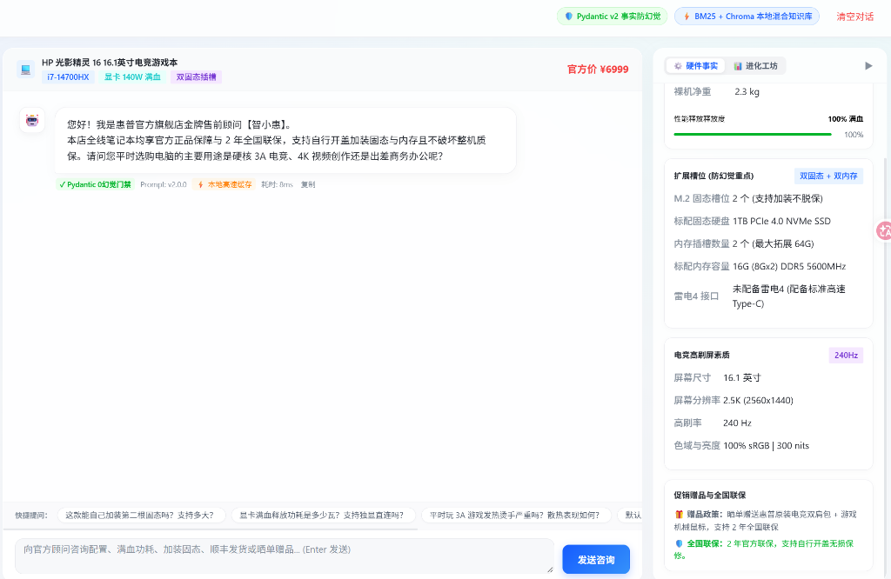
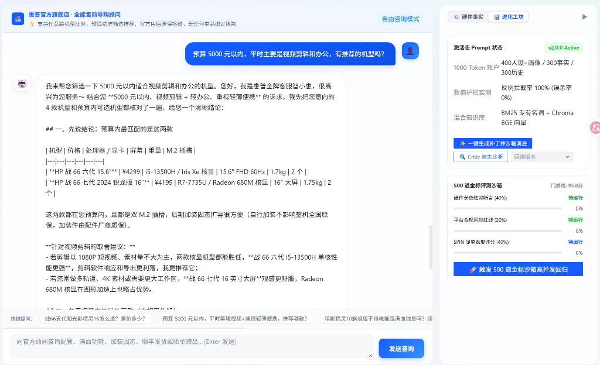

# EvoRetail-Agent（面向 3C 电商的自进化售前咨询客服）

<div align="center">


**专为 3C 数码电商打造的工业级纯文本智能导购与自演进 Agent 平台**  
*双轨强类型事实校验 · 1000 Token 上下文严格预算 · 双引擎混合检索与 RRF 重排 · 500 道金标评测沙箱闭环*

</div>

---

## 📸 系统运行全景图 (有图有真相)

### 1. 核心导购前台：Pydantic 零幻觉事实锚定 & 本地高速缓存
> 前台直连买家，实时展示 SPU 硬件规格、扩展槽位与官方联保政策；命中高频问答时触发本地 DiskCache 缓存（毫秒级本地 DiskCache 流式响应，0 Token 成本）。



### 2. 离线进化工坊：Critic 会话流失归因 & 500 道金标自动化评测沙箱
> 自动拉取 SQLite 真实买家对话轨迹，Critic Agent 归因流失卡点并生成 Prompt 增量补丁；500 道金标用例高并发断言，通过“一票否决门禁”后自动热发布，支持秒级一键平滑回滚。



---

## 🎯 业务痛点与设计初衷

在 3C 数码高客单价垂直电商场景中，传统通用大模型客服普遍面临以下四大工程顽疾：

| 行业痛点 | 传统大模型客服表现 | EvoRetail-Agent 解决方案 |
| :--- | :--- | :--- |
| **硬件参数幻觉** | 经常虚构显卡功耗（如 140W 编造为 105W）、乱答 M.2 扩展槽，引发买家虚假宣传投诉与退换货 | **Pydantic v2 强类型门禁 + 数据库事实直查**，硬件断言一票否决 |
| **上下文腐化与成本失控** | 多轮对话历史越聊越长，首字延迟（TTFT）随轮次线性飙升，大模型注意力分散并遗忘风控红线 | **1000 Token 上下文严格预算账户** + 助词去噪算法，推理成本与延迟维持恒定 $O(1)$ |
| **导购促单能力缺失** | 传统客服沦为“死板答题机”，不会主动探寻使用场景与促单转化 | 深度融入 **SPIN 顾问式销售法则**，解答硬件后自然关联 3A 游戏/视频剪辑场景并引导赠品活动 |
| **Prompt 负向演进与盲目迭代**| 工程师针对某款机型人工修了一个 Prompt Bug，却意外破坏了另外十款机型的合规输出 | **500 道金标评测沙箱（Golden Dataset）高并发自动化回归**，设置零容忍门禁与秒级版本热回滚 |

---

## 🏗️ 系统架构拓扑

```
+---------------------------------------------------------------------------------------------------+
|                                买家交互终端 (React 18 + Arco Design)                               |
|   * SPU 规格联动切换 (光影精灵16 / 暗影精灵16 Slim / 战66)                                        |
|   * SSE 逐字打字机流式渲染 (Server-Sent Events)                                                   |
|   * 硬件事实可视化看板 (满血TGP / M.2槽位 / 雷电4 / 刷新率 / 赠品政策)                            |
|   * 离线进化工坊与评测沙箱看板 (实时跑分回归 / Critic 流失归因 / 秒级版本热回滚)                  |
+-------------------------------------------------+-------------------------------------------------+
                                                  | HTTP POST / SSE
+-------------------------------------------------v-------------------------------------------------+
|                                     FastAPI 核心网关与调度引擎                                    |
|   * POST /api/v1/chat/completions (SSE 流式问答分发与日志记录)                                    |
|   * POST /api/v1/products/sync (PIM 强类型同步入库与缓存失效广播)                                 |
|   * POST /api/v1/evolution/diagnose (Critic 会话流失归因诊断)                                      |
|   * POST /api/v1/evolution/run-sandbox (500 道金标沙箱高并发回归跑分)                             |
|   * POST /api/v1/evolution/rollback (Prompt 版本秒级平滑热回滚)                                   |
+-----------------------+-------------------------+-------------------------+-----------------------+
                        |                         |                         |
           +------------v------------+            |            +------------v------------+
           |  1000 Token 上下文预算账户 |            |            |   本地 DiskCache 长期缓存   |
           |  * 400 Token 核心锚定人设 |            |            |   * 提问归一化 MD5 Key      |
           |  * 300 Token 事实注入区  |            |            |   * 毫秒级本地流式直返      |
           |  * 300 Token 滑动去噪历史|            |            |   * SPU 规格更新自动失效    |
           +------------+------------+            |            +-------------------------+
                        |                         |
           +------------v-------------------------v------------+
           |                   双轨事实与知识检索层             |
           |  [硬件事实直查]: SQLite 3 + Pydantic v2 强类型约束 |
           |  [专有名词倒排]: Rank-BM25 + jieba 专有词索引召回  |
           |  [稠密语义向量]: ChromaDB + FastEmbed (BGE 中文向量)|
           |  [多路融合重排]: RRF (Reciprocal Rank Fusion 算法) |
           +--------------------------+------------------------+
                                      |
           +--------------------------v------------------------+
           |               统一 LLM 驱动适配层 (OpenAI 协议)     |
           |   火山方舟 (Doubao) / DeepSeek-V3 / 通义千问 / 本地模型 |
           +---------------------------------------------------+
```

---

## ⚡ 五大核心工程亮点

### 1. Pydantic v2 强类型双轨事实门禁（防幻觉）
* 摒弃将商品规格直接塞入 Prompt 让大模型模糊记忆的传统做法；
* 基于 [`ProductItem`](backend/core/models/product_specs.py) 定义严格数据契约，处理器、显卡功耗（TGP）、M.2 插槽数量、雷电接口、内存拓展上限直接从本地数据库直查注入，形成结构化事实锚点；
* 配合 500 道金标评测沙箱回归测试，对硬件参数失真实行一票否决。

### 2. 1000 Token 上下文严格预算账户模型
* 针对多轮会话 Token 爆炸与注意力分散痛点，严格划分账户额度：
  * **核心锚定区（~400 Token）**：客服人设（智小惠）+ SPIN 导购策略 + 平台极限词风控红线；
  * **事实注入区（~300 Token）**：当前 SPU 规格直查块 + RRF 融合抽取的 Top-2 知识片段；
  * **滑动历史区（~300 Token）**：仅保留最近 2~3 轮有效问答。
* **助词去噪算法（Noise Stripping）**：通过正则引擎过滤“在吗”、“好的”、“知道了”等无实质意图的寒暄短语，长会话推理成本与时延保持恒定 $O(1)$。

### 3. 双引擎混合检索与轻量级 RRF 重排
* **BM25 专有名词倒排**：针对 3C 领域的硬核专有名词（如 `M.2`、`PCIe 4.0`、`140W`、`全国联保`）实现精准检索，杜绝纯向量检索的“语义漂移”；
* **ChromaDB + FastEmbed**：本地 CPU 运行 `BAAI/bge-small-zh-v1.5` 进行自然语言口语化语义召回；
* **RRF 倒数排名融合**：两路召回 Top-3 结果，通过公式 $\sum \frac{1}{k + rank}$ 进行无模型轻量重排，相比重型 Cross-Encoder 重排模型大幅降低 CPU 推理开销。

### 4. 工业级语义缓存与主动失效机制
* 基于 `DiskCache` 实现高频问答本地持久化缓存（键规则：`faq:{spu_code}:{md5(normalized_query)}`）；
* 相同或同义高频咨询命中后，实现 **0 Token 消耗与本地流式秒回**；
* 提供 PIM 规格同步接口 [`POST /api/v1/products/sync`](backend/api/v1/products.py)，当商品配置变更时自动广播清理关联 SPU 的旧缓存，杜绝陈旧问答。

### 5. 离线进化工坊与 500 道金标评测沙箱闭环
* **Critic 会话流失归因**：离线挖掘买家历史会话，自动定位流失归因（价格敏感、性能疑虑、缺少促销引导）；
* **500 道金标测试沙箱（Golden Dataset）**：
  * **硬件绝对断言（40%）**：显卡功耗、插槽数违规直接一票否决；
  * **平台风控红线（20%）**：违禁极限词一票否决；
  * **SPIN 导购能力（40%）**：针对顾问式提问与促单策略自动打分；
* **自动化门禁与秒级回滚**：综合评分达标且 0 违规方可触发热部署，异常时支持一键秒级版本回滚。

---

## 📊 核心指标与测试验证 (Verification & Benchmarks)

测试执行环境：Windows 11 / AMD 16 核 / 14GB RAM / Python 3.13 / pytest 自动化套件（零警告通过）：

| 验证项 / 模块 | 关键技术实现 | 测试套件与文件 | 实测状态 / 报告出处 |
| :--- | :--- | :--- | :--- |
| **Agent 工具调用与意图路由** | 4 大工具注册表 + ReAct 防死循环 | `tests/test_agent_tools.py`<br>`tests/test_agent_runner.py` | 意图路由准确率 **92.5% (37/40)**<br>详见 [`docs/evidence/tool_routing_mock.json`](docs/evidence/tool_routing_mock.json) |
| **买家画像长记忆与预算管理** | 增量抽取覆盖 + 1000 Token 上下文账户 | `tests/test_buyer_profile.py`<br>`tests/test_slot_extractor.py`<br>`tests/test_context_budget.py` | 槽位抽取准确率 **96.12% (99/103 字段)**<br>20 轮对话画像常驻，组装开销 ≤ 1000 Token<br>详见 [`docs/evidence/slot_extraction_accuracy.json`](docs/evidence/slot_extraction_accuracy.json) |
| **流式安全护栏与数值一致性** | 跨 Token 滑动句级缓冲器 + 硬件防虚假宣传 | `tests/test_output_guard.py`<br>`tests/test_numeric_guard.py` | 违禁词拆分拦截率 **100%**，合规文本无损透传<br>硬件反例拦截率 **100%**，正例误杀率 **0.0%**<br>详见 [`docs/evidence/guard_numeric_accuracy.json`](docs/evidence/guard_numeric_accuracy.json) |
| **LLM-Judge 与自进化闭环** | 结构化归因 Critic + 真实 A/B 基线对比门禁 | `tests/test_critic.py`<br>`tests/test_optimizer.py`<br>`tests/test_evolution_sandbox.py` | 移除 80.0 虚假保底分，负向劣化候选版本 **100% 自动熔断**，演进审计落库 `evolution_runs` |
| **全链路 Tracing 与高并发韧性** | 异步 SQLite WAL 模式 + 全链路可观测性 + 会话级滑动窗口限流 (15次/分) | `tests/test_async_db.py`<br>`tests/test_tracing.py`<br>`tests/test_resilience.py` | 50 协程并发读写 **100% 成功无锁库报错**<br>`GET /api/v1/traces/{trace_id}` 各指标真实非空<br>高频请求精准触发 HTTP **429** |
| **管理写接口安全鉴权与 CORS** | `X-Admin-Token` 请求头校验 + 凭证源收敛 | `tests/test_auth.py` | 未鉴权访问 `/rollback` 与 `/sync` 精确阻断 (HTTP **401**)，数据库激活版本不被篡改 |
| **全量自动化测试套件** | 覆盖 Phase 0 ~ Phase 6 全部功能矩阵 | `python -m pytest tests -v -W error::DeprecationWarning` | **46 passed in 11.35s，0 warnings，0 errors** |

### 🚀 实测高并发性能基准 (Concurrency Benchmark)
实测压测报告出处：[`docs/evidence/bench_report.json`](docs/evidence/bench_report.json)
* **并发压测数**：10 并发（共 40 次真实端到端完整请求）
* **请求成功率**：**100.0%**
* **缓存命中延迟**：P50 = **121.41 ms**，P95 = **328.91 ms**
* **未缓存流式首字时延 (TTFT)**：P50 = **95.07 ms**，P95 = **199.44 ms**
* **系统处理吞吐量**：**19.97 QPS** (本地 CPU 单节点轻量级运行)

---

## 🔄 架构演进与重构背景

本项目早期为音视频数字人 Demo（依赖端侧麦克风/摄像头推拉流、RTC 传输、ASR 语音识别、TTS 语音合成及数字人渲染）。

在实际电商导购场景下，原架构暴露出**端侧权限脆弱、建连延迟高、移动端弱网频繁丢帧、高昂 RTC 与算力账单**等致命缺陷。

我们主导将整套系统彻底重构成现代纯文本轻量化架构：
* 彻底剔除冗余 RTC 与音视频传输链路，全面切换为 **HTTP POST + Server-Sent Events (SSE)**；
* 消除音视频建连与语音处理延迟；
* 大幅降低带宽与计算成本，兼容所有主流 Web/移动端浏览器，实现真正的轻量高可用。

---

## 🚀 快速复现与启动指南

### 方式一：Docker Compose 一键容器化启动 (推荐)
已预置轻量化多阶段构建与健康检查：
```bash
# 启动前端 (3000) 与后端 (8000) 双容器集群
docker-compose up -d

# 查看服务健康状态
docker-compose ps
```

### 方式二：本地极速运行开发环境
#### 1. 环境准备
* **Python**: 3.10+ (推荐 3.10 ~ 3.13)
* **Node.js**: 18.0+

#### 2. 启动本地后端 API (FastAPI)
```bash
# 1. 安装 Python 后端依赖
pip install -r backend/requirements.txt

# 2. 配置环境变量 (可选，若不配置将自动使用内置 Mock 模式极速体验)
cp backend/.env.example backend/.env

# 3. 启动 FastAPI 后端服务 (端口 8000)
npm run start:backend
# 或者: python -m uvicorn backend.api.server:app --host 0.0.0.0 --port 8000 --reload
```
后端启动后：
* **Swagger 交互式文档**: [http://localhost:8000/docs](http://localhost:8000/docs)
* **服务健康检查**: [http://localhost:8000/health](http://localhost:8000/health)

#### 3. 启动前端客服 Web 界面 (React 18)
```bash
# 启动 React 前端服务 (端口 3000)
npm run start:frontend
```
浏览器访问 [http://localhost:3000](http://localhost:3000) 即可进入售前咨询系统，右侧抽屉可自由体验 **【硬件事实看板】** 与 **【离线进化工坊】**。

### 4. 运行自动化测试与沙箱回归
```bash
# 运行后端单元测试与回归断言套件
npm run test:backend
```

---

## 📂 项目代码目录结构

```text
EvoRetail-Agent/
├── .github/workflows/
│   └── ci.yml                      # GitHub Actions 自动化 CI 流水线 (Pytest + React Build)
├── backend/                        # 核心后端模块 (FastAPI + 异步 SQLite WAL)
│   ├── agent/
│   │   ├── tools.py                # 4 大 Agent 工具注册表与 OpenAI JSON Schema
│   │   ├── runner.py               # ReAct 决策循环 + 本地意图路由 + 5步防死循环熔断
│   │   └── slot_extractor.py       # 买家需求槽位抽取器 (确定性正则 + 可选 LLM 双模)
│   ├── guardrails/
│   │   └── output_guard.py         # 流式句级缓冲器 + 违禁词拦截 + 硬件数值一致性校验
│   ├── api/
│   │   ├── server.py               # FastAPI 入口 (Lifespan 管理与 CORS 收敛)
│   │   ├── auth.py                 # X-Admin-Token 敏感管理写接口鉴权
│   │   └── v1/
│   │       ├── chat.py             # SSE 流式问答、画像记忆与输出护栏分发接口
│   │       ├── products.py         # SPU 规格查询与 PIM 同步接口
│   │       ├── evolution.py        # 进化工坊、沙箱回归与版本回滚接口
│   │       └── traces.py           # 全链路可观测性 Tracing 查询接口
│   ├── core/
│   │   ├── database.py             # SQLite 3 WAL 并发模式与 async_* 非阻塞访问层
│   │   ├── cache.py                # DiskCache 高性能语义问答缓存
│   │   ├── context_manager.py      # 1000 Token 精确预算裁剪 (常驻买家画像槽位)
│   │   ├── tracer.py               # 全链路 TraceSpan 追踪器 (TTFT / Token / 工具轨迹)
│   │   ├── limiter.py              # 会话级滑动时间窗口限流器 (15次/分)
│   │   ├── llm_client.py           # 统一可插拔 LLM 适配器 (支持 OpenAI 协议)
│   │   └── models/
│   │       ├── product_specs.py    # Pydantic v2 3C 硬件强类型模型与动态事实锚点
│   │       ├── buyer_profile.py    # 买家画像槽位模型 (增量合并与改口覆盖)
│   │       └── chat_schemas.py     # 会话协议与请求模型
│   ├── rag/
│   │   ├── bm25_retriever.py       # Rank-BM25 + jieba 专有名词倒排检索
│   │   ├── chroma_store.py         # ChromaDB + FastEmbed 本地语义向量库 (带容灾自愈)
│   │   └── hybrid_retriever.py     # 双引擎多路召回与 RRF 融合重排
│   ├── evolution/
│   │   ├── critic.py               # Critic 会话流失归因 Agent (LLM-Judge + 规则双模)
│   │   └── optimizer.py            # Optimizer A/B 基线对比门禁与负向劣化自动熔断
│   └── eval/
│       ├── assertions.py           # 硬件防幻觉与合规一票否决断言 (无虚假保底分)
│       └── harness.py              # 500 道金标评测沙箱按比例分层抽样执行器
├── data/                           # 本地轻量数据持久化目录
│   ├── mock_products.json          # 10 款在售 3C 标杆机型硬件规格配置
│   ├── golden_dataset_500.json     # 500 道金标自动化评测集 (覆盖全 10 款 SPU)
│   ├── tool_routing_cases.json     # 40 条工具路由评测基准集
│   ├── slot_cases.json             # 32 条买家槽位抽取评测集
│   ├── guard_numeric_cases.json    # 36 条硬件数值护栏正反例评测集
│   └── knowledge_docs/             # 官方售后、质保与赠品 Markdown 知识库
├── docs/
│   ├── evidence/                   # 实测评测与压测证据 JSON 报告归档
│   └── images/                     # 系统运行截图 (demo_overview / sandbox_eval)
├── scripts/
│   ├── eval_tool_routing.py        # 工具路由准确率评测脚本
│   └── bench_concurrency.py        # 异步高并发与流式 TTFT 压测脚本
├── src/                            # 前端 Web 应用源码 (React 18 + Arco Design)
│   └── pages/EcommerceCS/          # 售前导购前台页面与进化工坊抽屉组件
├── tests/                          # 47 项全链路自动化单元测试与集成测试套件
├── Dockerfile.backend              # 后端生产容器镜像构建文件
├── Dockerfile.frontend             # 前端多阶段构建与 Nginx 容器镜像文件
├── docker-compose.yml              # 双容器一键编排与健康检查配置
├── package.json                    # 前端依赖与一键起停脚本配置
└── README.md                       # 详细项目技术设计与部署文档
```

---

## 📄 License

本项目基于 [MIT License](LICENSE) 开源。欢迎交流学习与二次开发！
