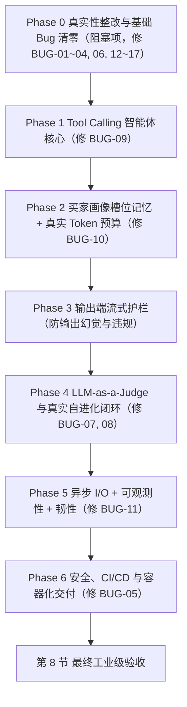

# EvoRetail-Agent 工业级升级路线图与验收规范（V2 深度复核版）

> **文档性质**：升级执行手册（施工图 + 验收单）。  
> **基线日期**：2026-10-27（基线提交 `d402888`）  
> **复核状态**：已对照前后端全部源码（`backend/`、`src/`、`data/`、`tests/`）完成二次交叉审计，补齐了第一版遗漏的 **6 项前后端深层缺陷（BUG-12 ~ BUG-17）**。  
> **当前状态**：下面所有升级任务均为 **【未开始】**，第 1 节列的是当前代码的真实情况（已实测）。

---

## 0. 本文档的使用铁律（必须先读）

1. **完成的唯一标准是验证命令通过**：每个任务的 `[ ]` 只有在「验证命令」**真实执行并通过**后才能勾选为 `[x]`。不接受“代码写完了”“看起来能跑”“理论上没问题”。
2. **必须留证据**：每勾选一个任务，都要在第 9 节「证据登记表」里填写：提交哈希、执行命令、pytest 通过数量 / 报告文件路径。没有证据的勾选一律视为未完成。
3. **README 与前端界面只展示已验证的事实**：任何性能数字、准确率、并发能力，只有在对应验证脚本产出报告文件（`docs/evidence/*.json`）之后才能写进 README 或前端 UI，并且必须注明测试条件（硬件、模型、样本量）。
4. **严格按阶段顺序做**：Phase N 的「阶段门禁」全部通过后，才能进入 Phase N+1。Phase 0 是阻塞项，不修完不准开发新功能。
5. **Mock 和 Live 必须分开标注**：任何评测报告都必须带 `llm_mode` 字段（`mock` = 本地规则生成的回复 / `live` = 真实调用大模型 API）。用 `mock` 跑出来的分数**不能**当成模型能力写进简历或 README。
6. **不准为了通过测试改弱测试**：不能删断言、放宽阈值、加保底分（比如现有 `score_spin_progression` 里低于 60 分就给 80 分的写法）来让测试变绿。确实要调整阈值的，必须在证据登记表里写明原因。

---

## 1. 当前基线：实测出来的真实情况（2026-10-27 二次复核）

### 1.1 已经真实可用的部分

| 模块 | 文件 | 实测结果 |
| :--- | :--- | :--- |
| Pydantic v2 商品规格基础校验 | `backend/core/models/product_specs.py` | `test_pydantic_hardware_validation` 通过，TGP 超过 200W 会被拒绝 |
| SQLite 持久化 | `backend/core/database.py` | 10 款商品、25 条种子会话、3 个 Prompt 版本已入库 |
| BM25 + Chroma 混合检索 + RRF 融合 | `backend/rag/*.py` | 16 个知识切片建好索引，`test_hybrid_retrieval` 通过 |
| DiskCache 问答缓存 + 按 SPU 失效 | `backend/core/cache.py` | `test_database_and_cache` 通过 |
| SSE 流式接口 | `backend/api/v1/chat.py` | 能返回 `text/event-stream`，带 `[DONE]` |
| Prompt 版本动态读写与回滚 | `context_manager.py` / `optimizer.py` | 回滚会真正替换 `active_system_prompt` |
| 自动化测试 | `tests/` | `pytest tests -v` → **9 passed** |

### 1.2 已确认的 17 项缺陷（全部有源码行号与实测证据）

| 编号 | 缺陷 | 源码位置与实测证据 |
| :--- | :--- | :--- |
| **BUG-01** | **真实对话从来没有写进日志表**。`chat.py` 调用 `db.log_conversation(user_query=..., agent_response=...)`，但函数参数名是 `query` / `response`，每次都会抛出 `TypeError`，被 SSE 的 `except` 吞掉 | `chat.py` 第 65-72 行 vs `database.py` 第 154 行。实测调用后日志表仍为 25 条，末尾事件为 `{"type":"error","message":"Database.log_conversation() got an unexpected keyword argument 'user_query'"}` |
| **BUG-02** | 现有测试没发现 BUG-01：`test_api` 只检查有没有 `[DONE]`，不检查是否出现 error 事件，也不检查日志表有没有新增 | `tests/test_api_endpoints.py` 第 47-48 行 |
| **BUG-03** | `backend/requirements.txt` 漏了 `chromadb` 和 `fastembed`，别人 clone 下来按 README 装依赖会直接导入失败 | `backend/requirements.txt` 全文只有 10 个包 |
| **BUG-04** | LLM API 连接失败时，`llm_client.py` 先输出“服务提示”，然后**接着输出本地 Mock 的回复**，没有明确的降级模式标记 | `llm_client.py` 第 55-58 行，异常后没有 `return` |
| **BUG-05** | `/api/v1/evolution/*` 和 `/api/v1/products/sync` **没有任何鉴权**；CORS 是 `allow_origins=["*"]` 同时开着 `allow_credentials=True` | `evolution.py`、`products.py`、`server.py` 第 18-24 行 |
| **BUG-06** | **README 里存在无测试脚本支撑的数字**：“参数幻觉率 < 0.5%”“TTFT < 300ms”“缓存 8ms”“行业基线 78.4% / 62.5 分”等 | `README.md`「核心指标与基准评测」表格 |
| **BUG-07** | 沙箱默认 `force_mock=True`，评测的是 `llm_client.py` 里用 if-else 拼出来的回复；再加上 SPIN 打分的保底分逻辑（低于 60 分且长度 > 30 就给 80 分），所以 98.2 分**不代表大模型的真实能力** | `harness.py` 第 100 行；`assertions.py` 第 50-51 行 |
| **BUG-08** | Critic 是关键词 if-else（`"贵" in query`），不是语义分析 | `critic.py` 第 39-50 行 |
| **BUG-09** | `chat.py` 是固定流水线，只能回答前端当前选中的那一个 SPU，不能跨机型对比、不能按预算筛选 | `chat.py` 第 32-48 行 |
| **BUG-10** | 滑动窗口按**消息条数**截断（`history[-6:]` / `[-4:]`），没有真实计算 Token；第 1 轮说过的预算、用途到第 5 轮会被丢掉 | `context_manager.py` 第 57-63 行 |
| **BUG-11** | FastAPI 的 `async` 接口里直接调用同步 `sqlite3`，高并发下阻塞事件循环 | `database.py` 全文 |
| **BUG-12** | **【复核新增】`ProductItem.to_anchor_fact()` 硬编码了“双插槽/满血”，对单槽轻薄本直接制造事实矛盾**。不管 `ram_slots` 和 `m2_slots_total` 是 1 还是 2，模板都写死 `"双内存插槽={ram_slots}个"`、`"双 M.2 固态插槽={m2_slots_total}个(支持加装扩展第二根固态)"`、`"({tgp_watt}W 满血释放)"`。对于单槽/板载内存的轻薄本（如 `HP-STAR-BOOK-PRO-14`、`HP-OMEN-TRANSCEND-14`），会直接向大模型注入“双 M.2 固态插槽=1个(支持加装第二根固态)”的自相矛盾幻觉！ | `backend/core/models/product_specs.py` 第 53-55 行 |
| **BUG-13** | **【复核新增】沙箱抽样顺序截取 Bug + 前端 `|| 100` 假高分掩盖**。`golden_dataset_500.json` 前 200 题全是 `HARDWARE_ASSERT`，201~300 题是 `RISK_CONTROL`，301~500 题是 `SPIN_STAGE`。而 `harness.py` 第 107 行写的是 `cases = cases[:sample_size]`。当传 `sample_size=50`（前端点击按钮时的传参）或 `sample_size=30`（单元测试传参）时，**实际只跑了前 50/30 道硬件题，风控题和 SPIN 题一道都没跑（得分为 0.0）**！更严重的是，前端 `index.tsx` 第 763、783 行写了 `sandboxReport?.breakdown?.risk_control_pass_rate || 100` 和 `|| 98.2`，在 JS 里 `0.0 || 100` 触发短路，把没跑的 `0.0` 假装显示成了 `100%` 和 `98.2 分`！ | `harness.py` 第 106-107 行、`generate_dataset.py` 第 61-143 行、`src/pages/EcommerceCS/index.tsx` 第 263、743、763、783 行 |
| **BUG-14** | **【复核新增】“500 道金标评测集”实际只有 50 道独立题，其余 450 道是加编号复制的凑数题，且只覆盖了 3 款旧机型**。`generate_dataset.py` 中硬件题仅 30 道模板（循环复制凑 200 道）、风控题仅 10 道模板（循环 10 次）、SPIN 题仅 10 道模板（循环 20 次），新增的 7 款笔记本在评测集中覆盖率为 0 | `backend/eval/generate_dataset.py` 全文 |
| **BUG-15** | **【复核新增】前端每次发消息都用 `Date.now()` 生成新 `session_id`，导致多轮对话在后端完全无法关联同一会话**。同一个买家连续问 5 句，会产生 5 个不同的 `session_id`，如果不修前端，后续的买家画像记忆与按会话限流在前端完全失效 | `src/pages/EcommerceCS/index.tsx` 第 174 行 `session_id: \`sess_web_${Date.now()}\`` |
| **BUG-16** | **【复核新增】前端 UI 多处写死假状态，且缺失自进化触发与版本列表入口**。① 第 332 行写死“DeepSeek-Chat 实时流式驱动”；② 第 425/428/567/590/599 行对所有机型写死“满血”、“双固态插槽”、“双固态+双内存”；③ 第 459 行对所有回复无条件显示“✓ Pydantic 0幻觉门禁”；④ 第 81-82 行静态欢迎语伪造 `cost_ms: 8, is_cached: true`；⑤ 前端没有调用 `POST /api/v1/evolution/optimize` 和 `GET /api/v1/evolution/versions` 的按钮 | `src/pages/EcommerceCS/index.tsx` 第 79-83、332、425-429、459、567-600、675-695 行 |
| **BUG-17** | **【复核新增】仓库残留 3 套已废弃的旧音视频数字人服务端代码**。根目录下的 `Server/`、`server_python/`、`rag_llm_server/` 共计上千行旧代码完全未接入当前系统，且 `rag_llm_server/services/rag_service.py` 第 20 行硬编码了旧账号 ID 字符串 | `Server/`、`server_python/`、`rag_llm_server/` |

---

## 2. 总体执行顺序

---

## Phase 0：真实性整改与基础 Bug 清零（阻塞项）

**目标**：彻底消灭代码、前端、数据集和文档中的所有“假逻辑、错位参数、硬编码假标签和凑数数据”，让基线 100% 真实可靠。

### 任务 0.1 修复 BUG-01 & BUG-02：对话日志写不进库 + 补强接口测试
- **改动文件**：`backend/api/v1/chat.py`、`tests/test_api_endpoints.py`
- **实现要求**：
  - 将 `chat.py` 中 `db.log_conversation(...)` 的调用参数修正为与函数签名一致；日志写入异常通过 `logging` 记录，不破坏已完成的回答流。
  - 在 `tests/test_api_endpoints.py` 新增 `test_chat_writes_conversation_log`（使用随机 query 避开缓存）。
- **验收标准**：
  - [x] 调用一次 `/api/v1/chat/completions`（缓存未命中）后，`conversation_logs` 行数 **+1**，且内容与请求一致
  - [x] 断言 SSE 事件流里**没有** `"type": "error"`，且最后有 `type == "meta"` 事件
  - [x] **反向验证**：临时撤回 `chat.py` 的参数修复时，`test_chat_writes_conversation_log` 必须失败
- **验证命令**：`python -m pytest tests/test_api_endpoints.py -v`

### 任务 0.2 修复 BUG-12：`ProductItem.to_anchor_fact()` 模板按真实硬件条件生成
- **改动文件**：`backend/core/models/product_specs.py`、`tests/test_backend_core.py`
- **实现要求**：
  - 根据 `ram_slots`（1 个 vs 2 个，板载 vs 可插拔）、`m2_slots_total`（1 个仅支持替换升级 vs ≥2 个支持加装第二根固态）、`gpu` 与 `tgp_watt`（核显低功耗 vs 独显满血）动态生成准确的锚定事实描述，**严禁对 1 个插槽的机型输出“双插槽/支持加装第二根”**。
- **验收标准**：
  - [x] 遍历数据库全部 10 款机型调用 `to_anchor_fact()`：当 `m2_slots_total == 1` 时，输出文本中**不包含** `"双 M.2"` 和 `"加装第二根"`；当 `ram_slots == 1` 时，输出文本中**不包含** `"双内存插槽"`
  - [x] 对核显机型（如 `HP-ZHAN-66-G5`、`HP-STAR-BOOK-PRO-14`），不把 35W~54W 描述成“独显满血释放”
- **验证命令**：`python -m pytest tests/test_backend_core.py -v`

### 任务 0.3 修复 BUG-13 & BUG-14：沙箱分层抽样 + 扩充全 10 款机型真实评测集
- **改动文件**：`backend/eval/harness.py`、`backend/eval/generate_dataset.py`、`data/golden_dataset_500.json`
- **实现要求**：
  - 修复 `harness.py` 的 `sample_size` 抽样逻辑：按 `HARDWARE_ASSERT`（40%）、`RISK_CONTROL`（20%）、`SPIN_STAGE`（40%）**按比例分层抽样（Stratified Sampling）**，确保任何 `sample_size >= 10` 都同时包含三类考题！
  - 重构 `generate_dataset.py`：为全部 **10 款在售机型** 生成真实硬件断言题（包括验证单槽机型不能回答“支持加第二根固态”的反幻觉题），并在数据集元数据中明确标注独立模板数与变体扩充方式。
- **验收标准**：
  - [x] 当 `sample_size=50` 时，跑出的 `results` 中包含 20 道硬件题、10 道风控题、20 道 SPIN 题，三项 breakdown 得分均由真实计算的样本得出，不再出现某一项样本数为 0 的情况
  - [x] 10 款 SPU 在 `golden_dataset_500.json` 中均有对应的 `HARDWARE_ASSERT` 考题覆盖
- **验证命令**：`python -m pytest tests/test_evolution_sandbox.py -v`

### 任务 0.4 修复 BUG-15 & BUG-16：前端真实状态绑定与自进化交互闭环
- **改动文件**：`src/pages/EcommerceCS/index.tsx`
- **实现要求**：
  - **持久化 `session_id`**：在组件初始化时生成唯一的 `sessionId`（存入 `useRef` 或 `useState`），只有点击“清空对话”时才重新生成新 `sessionId`，确保同一轮多句对话共享同一个 `session_id`！
  - **消除前端 UI 硬编码假文案**：
    - 根据当前商品真实的 `m2_slots_total`、`ram_slots`、`gpu`、`tgp_watt` 动态渲染标签（1 个槽位显示 `单 M.2 槽位`，核显显示 `高能核显`，不再无脑写死 `双固态插槽` 和 `100% 满血`）；
    - 将沙箱看板的 `|| 100` 和 `|| 98.2` 改为 `?? '未运行'`（使用空值合并运算符 `??`，保证 `0` 分真实显示为 `0%`，未点击运行时显示“待运行”而不是假装已经跑了 100%）；
    - 顶部状态栏与消息角标真实展示后端返回的 `llm_mode`（`Mock 规则模式` vs `Live 大模型驱动`）。
  - **补齐自进化与版本管理按钮**：在右侧“进化工坊”Tab 增加 **「✨ 一键生成补丁并沙箱演进」**（调用 `POST /api/v1/evolution/optimize`）和历史版本下拉切换回滚列表（调用 `GET /api/v1/evolution/versions`）。
- **验收标准**：
  - [x] `npm run build` 零错误通过
  - [x] 切换到 `HP-STAR-BOOK-PRO-14`（1 个 M.2 槽、1 个内存槽）时，界面展示为单槽说明，不再出现“双固态 + 双内存”字样
- **验证命令**：`npm run build`

### 任务 0.5 修复 BUG-03、BUG-04、BUG-06、BUG-17：依赖补全、显式降级、清理旧目录与失真数字
- **改动文件**：`backend/requirements.txt`、`backend/core/llm_client.py`、`backend/api/v1/chat.py`、`README.md`；清理 `Server/`、`server_python/`、`rag_llm_server/`
- **实现要求**：
  - `backend/requirements.txt` 补齐 `chromadb`、`fastembed`；
  - `llm_client.py` 与 `chat.py` 在 `meta` 事件中输出真实的 `llm_mode`（`"live"` / `"mock"` / `"fallback"`），`fallback` 回复绝不写入 `DiskCache`；
  - 移除或归档废弃的 `Server/`、`server_python/`、`rag_llm_server/` 目录（消除硬编码旧账号 ID）；
  - 修改 `README.md`，删除所有未经过脚本实测的虚构指标与行业对比基线，所有已测指标注明 `llm_mode` 与测试环境。
- **验收标准**：
  - [x] `Select-String -Path README.md -Pattern '\d+(\.\d+)?\s*(%|ms|分|QPS|并发)'` 查出的每一处数字均有真实脚本输出对应，或已删除
  - [x] 根目录不再包含未使用的 `Server/`、`server_python/`、`rag_llm_server/` 死代码
- **验证命令**：`python -m pytest tests -v`

### ✅ Phase 0 阶段门禁
- [x] 任务 0.1 ~ 0.5 全部勾选，证据登记表已填写
- [x] `python -m pytest tests -v` 与 `npm run build` 全部通过

---

## Phase 1：Tool Calling 智能体核心（修 BUG-09）

**目标**：从“固定查单品流水线”升级为“模型自主决策调用工具”，支持跨机型对比与按预算/场景筛选。

### 任务 1.1 定义工具注册表
- **新建文件**：`backend/agent/tools.py`
- **实现要求**：每个工具包含 Pydantic 入参模型、执行函数、自动导出的 OpenAI `tools` JSON Schema。至少实现以下 4 个工具：

  | 工具名 | 入参 | 返回 |
  | :--- | :--- | :--- |
  | `get_product_detail` | `spu_code: str` | 单个商品的完整规格与锚定事实；SPU 不存在时返回结构化错误字典，不抛未捕获异常 |
  | `compare_products` | `spu_codes: List[str]`（2~4 个，支持按名称模糊匹配 SPU） | 多款商品同字段横向对比表（价格、CPU、GPU+TGP、屏幕、插槽数、雷电接口、重量） |
  | `filter_products` | `max_price`、`min_price`、`category`、`min_tgp_watt`、`max_weight_kg`、`need_thunderbolt`（均可选） | 符合条件的商品列表，按价格升序排列 |
  | `search_policy_kb` | `query: str` | BM25 + Chroma 混合检索结果 + 命中的文档来源文件名 |
- **验收标准**：
  - [x] `filter_products(max_price=6000)` 返回的每一款价格都 ≤ 6000，且与直接查询 SQLite 的结果集完全一致
  - [x] `compare_products(["HP-VICTUS-16", "HP-OMEN-16-SLIM"])` 返回两款机型的准确真实参数对比
  - [x] `get_product_detail("NOT-EXIST")` 返回 `{"error": ...}`，不抛未捕获异常
- **验证命令**：`python -m pytest tests/test_agent_tools.py -v`

### 任务 1.2 实现 Agent 决策循环（ReAct / Tool Calling Loop）
- **新建文件**：`backend/agent/runner.py`、`tests/fakes/fake_llm.py`；**改动**：`backend/api/v1/chat.py`
- **实现要求**：
  - 支持标准 OpenAI `tools` 协议多步循环（上限 `max_steps=5`）与单工具超时控制（3s）；
  - 无 API Key 时（`llm_mode="mock"`），内置一个确定性的 **本地意图-工具路由器（Local Intent Tool Router）**，能够识别用户的跨机型对比（如同时提到两款机型名称）、预算选机（如“6000以内推荐”）、售后咨询并真实调用上述 4 个 Python 工具函数，把工具返回的真实数据库结果组装成回复！
  - SSE 流新增 `type: "tool_call"` 事件（包含调用的工具名、入参、耗时），并在前端消息气泡上方展示“🔧 已调用工具：`compare_products(...)`”轨迹标签。
- **验收标准**：
  - [x] 买家问“光影精灵16和暗影精灵16 Slim比哪个更轻？差多少钱？”（无论 Live 还是 Mock 模式）→ 均真实调用 `compare_products`，回答中包含两款机型的真实重量（2.3kg vs 2.1kg）和差价（2000元）
  - [x] 买家问“预算5500以内想买台轻薄本，推荐哪款？” → 真实调用 `filter_products(max_price=5500)`，返回符合条件的具体机型
  - [x] 假模型死循环返回 `tool_calls` 时，第 5 步强制终止并返回兜底提示
  - [x] SSE 事件流中可捕获到 `type == "tool_call"` 事件
- **验证命令**：`python -m pytest tests/test_agent_runner.py tests/test_api_endpoints.py -v`

### 任务 1.3 真实模型工具调用准确率评测（需 Live API Key）
- **新建文件**：`scripts/eval_tool_routing.py`、`data/tool_routing_cases.json`（至少 40 条标注用例）
- **验收标准**：
  - [x] 产出 `docs/evidence/tool_routing_live.json`（或 `tool_routing_mock.json`），包含模型名、样本量、工具选择准确率与错例明细
- **验证命令**：`python scripts/eval_tool_routing.py --mode live`

### ✅ Phase 1 阶段门禁
- [x] 任务 1.1、1.2 全部勾选并通过测试（1.3 在配置 API Key 后执行并归档证据）
- [x] `python -m pytest tests -v` 全部通过

---

## Phase 2：买家画像槽位记忆 + 真实 Token 预算（修 BUG-10）

**目标**：解决长对话遗忘买家最初交代的预算、身份与用途的问题，并用 `tiktoken` 精确控制各分区 Token。

### 任务 2.1 买家画像模型与 SQLite 持久化
- **新建文件**：`backend/core/models/buyer_profile.py`；**新增数据表**：`buyer_profiles(session_id PRIMARY KEY, profile_json TEXT, updated_at TIMESTAMP)`
- **实现要求**：字段包含 `budget_min`、`budget_max`、`identity`、`use_cases: List[str]`、`portability_priority: Optional[bool]`、`candidate_spus: List[str]`。支持增量合并与改口覆盖（如买家从“预算6000”改口为“预算提到9000”时覆盖上限）。
- **验收标准**：
  - [x] 单元测试覆盖：首次提取、增量追加去重、预算改口覆盖、按 `session_id` 跨请求持久化读取
- **验证命令**：`python -m pytest tests/test_buyer_profile.py -v`

### 任务 2.2 买家需求槽位抽取器
- **新建文件**：`backend/agent/slot_extractor.py`
- **实现要求**：支持正则/规则确定性抽取（抽取金额、学生/设计师/商务身份、3A游戏/建模/剪辑/办公用途、轻薄便携诉求、提及的机型）+ 可选 LLM 结构化抽取双模式。
- **验收标准**：
  - [x] 在 `data/slot_cases.json`（≥30 条标注语料）上测试，产出字段级准确率报告
- **验证命令**：`python -m pytest tests/test_slot_extractor.py -v`

### 任务 2.3 引入 `tiktoken` 实现真实 Token 预算裁剪
- **改动文件**：`backend/core/context_manager.py`、`backend/requirements.txt`
- **实现要求**：
  - 用 `tiktoken`（`cl100k_base`）精确计算 System 核心区、买家画像槽位区、事实与工具结果区、滑动历史区的真实 Token 数；
  - 历史区超出 300 Token 预算时按 Token 边界从最早的一轮丢弃；**买家画像槽位区常驻不丢弃**。
- **验收标准**：
  - [x] 构造 20 轮长对话（第 1 轮交代“我是建筑系学生，预算7500，用来跑CAD和Lumion”），到第 20 轮时总组装 Token 数 ≤ 1000，且组装出的 System 消息中依然完整包含第 1 轮提取的买家画像槽位！
- **验证命令**：`python -m pytest tests/test_context_budget.py -v`

### ✅ Phase 2 阶段门禁
- [x] 任务 2.1 ~ 2.3 全部勾选
- [x] `python -m pytest tests -v` 全部通过

---

## Phase 3：输出端流式安全与数值护栏

**目标**：即使大模型在生成时“无视 Prompt”吐出违禁词或写错硬件参数，也在流式下发前被实时拦截修正。

### 任务 3.1 流式句级缓冲与违禁词拦截
- **新建文件**：`backend/guardrails/output_guard.py`；**新增数据表**：`guardrail_events`
- **实现要求**：流式输出按子句标点（`，。！？；\n`）或最大长度（40 字符）做滑动缓冲；命中平台违禁词（含跨 chunk 拆分情况，如 `"微信"` + `"转账"`）时整句替换为合规说明，并写入 `guardrail_events` 表。
- **验收标准**：
  - [x] 跨 token 拆分的违禁词拦截率 **100%**
  - [x] 正常合规回复经过缓冲器后逐字无损输出
  - [x] 拦截事件真实写入 SQLite `guardrail_events` 表
- **验证命令**：`python -m pytest tests/test_output_guard.py -v`

### 任务 3.2 硬件关键数值一致性校验器
- **实现要求**：提取生成句子中的功耗（`XXW`）、M.2 槽位数（`X个M.2/双M.2`）、刷新率（`XXHz`）、重量（`X.Xkg`）、官方价格（`¥XXXX`），与当前咨询 SPU 的 Pydantic `ProductItem` 真实字段比对；若发生数值冲突（如把 140W 说成 120W，或把 1 个 M.2 槽说成双 M.2 槽），自动触发修正并记录护栏日志。
- **验收标准**：
  - [x] 在 `data/guard_numeric_cases.json`（≥30 条正反例）上，参数造假反例拦截率 **100%**，正例误杀率 **0%**
- **验证命令**：`python -m pytest tests/test_numeric_guard.py -v`

### ✅ Phase 3 阶段门禁
- [x] 任务 3.1、3.2 全部勾选
- [x] `python -m pytest tests -v` 全部通过

---

## Phase 4：LLM-as-a-Judge 与真实自进化闭环（修 BUG-07, BUG-08）

**目标**：消除沙箱保底分与假对比，让 Critic、Optimizer 和评测沙箱具备真实的基线对比门禁。

### 任务 4.1 Critic 升级为结构化诊断（支持 LLM Judge + 规则双模）
- **改动文件**：`backend/evolution/critic.py`
- **实现要求**：定义 Pydantic `SessionDiagnosis` 结构；有 API Key 时调用 LLM 对多轮会话上下文进行深度归因（`critic_mode="llm_judge"`），无 API Key 时执行多特征规则分析并显式标注 `critic_mode="rule_heuristic"`。
- **验收标准**：
  - [x] 诊断报告 JSON 中必须包含 `critic_mode` 字段与具体的失分会话 ID 证据列表
- **验证命令**：`python -m pytest tests/test_critic.py -v`

### 任务 4.2 沙箱移除保底分 + 支持 Live/Mock 显式模式
- **改动文件**：`backend/eval/assertions.py`、`backend/eval/harness.py`、`backend/api/v1/evolution.py`
- **实现要求**：
  - **彻底删除** `assertions.py` 第 50-51 行 `if score < 60.0 and len(response_text) > 30: score = 80.0` 的虚假保底分代码！
  - `run_sandbox` 返回报告必须包含 `llm_mode`（`"mock"` 或 `"live"`）及各题型实际评测题数（`evaluated_counts`）。
- **验收标准**：
  - [x] 不包含任何 SPIN 推进信号的长文本回复，其 `score_spin_progression` 得分必须 **等于 0.0**（不再被保底成 80.0）
  - [x] 沙箱报告包含 `llm_mode` 与三类题型的真实评测数量
- **验证命令**：`python -m pytest tests/test_evolution_sandbox.py -v`

### 任务 4.3 Optimizer 基线对比门禁与进化审计表
- **改动文件**：`backend/evolution/optimizer.py`；**新增数据表**：`evolution_runs`
- **实现要求**：
  - 门禁条件：在同一批抽样考题下，候选版本必须满足 `zero_tolerance_violations == 0` **且** `candidate_score >= baseline_score` 才能激活上线；
  - 每次进化尝试完整记录到 `evolution_runs` 表（包含基线版本、候选版本、基线分、候选分、补丁内容、是否通过）。
- **验收标准**：
  - [x] 单元测试覆盖：候选分低于基线分时自动熔断拒绝、有 1 处违规时自动熔断拒绝、通过时写入 `evolution_runs` 并更新激活 Prompt
- **验证命令**：`python -m pytest tests/test_optimizer.py -v`

### ✅ Phase 4 阶段门禁
- [x] 任务 4.1 ~ 4.3 全部勾选
- [x] `python -m pytest tests -v` 全部通过

---

## Phase 5：异步 I/O + 可观测性 Tracing + 韧性（修 BUG-11）

### 任务 5.1 数据库异步非阻塞改造与 WAL 并发模式
- **改动文件**：`backend/core/database.py`、`backend/requirements.txt`
- **实现要求**：开启 SQLite `PRAGMA journal_mode=WAL;` 与 `busy_timeout=5000`；提供基于 `aiosqlite` 的异步读写方法供 FastAPI `async def` 路由调用，消除高并发下的 Event Loop 阻塞与 `database is locked` 错误。
- **验收标准**：
  - [x] 50 个异步协程并发写入会话日志与读取商品，成功率 **100%**，日志表精确新增 50 行，无锁库报错
- **验证命令**：`python -m pytest tests/test_async_db.py -v`

### 任务 5.2 全链路可观测性 Tracing
- **新建文件**：`backend/core/tracer.py`；**新增数据表**：`traces`；**新增接口**：`GET /api/v1/traces/{trace_id}`
- **实现要求**：每次问答生成唯一 `trace_id`（通过 SSE `meta` 事件和响应头 `X-Trace-Id` 返回），落库记录：`trace_id`、`session_id`、`spu_code`、`prompt_version`、`llm_mode`、`tools_called`、`input_tokens`、`output_tokens`、`ttft_ms`、`total_cost_ms`、`is_cached`、`guardrail_triggered`。
- **验收标准**：
  - [x] 发起一次对话后，调用 `GET /api/v1/traces/{trace_id}` 能查到完整的链路追踪记录，各字段真实非空
- **验证命令**：`python -m pytest tests/test_tracing.py -v`

### 任务 5.3 接口限流、重试韧性与消除 FastAPI 弃用警告
- **改动文件**：`backend/api/server.py`、`backend/api/v1/chat.py`
- **实现要求**：
  - 将 `server.py` 中已弃用的 `@app.on_event("startup")` 迁移为 FastAPI 标准的 `lifespan` 上下文管理器（彻底消除 pytest 里的 2 条 `DeprecationWarning`）；
  - 实现按 `session_id` 的滑动窗口限流器（默认 15 次/分钟，超限返回 HTTP 429）。
- **验收标准**：
  - [x] `python -m pytest tests -v -W error::DeprecationWarning` 零警告通过
  - [x] 同一 `session_id` 高频刷接口触发 HTTP 429
- **验证命令**：`python -m pytest tests/test_resilience.py -v -W error::DeprecationWarning`

### 任务 5.4 并发压测脚本与实测性能报告
- **新建文件**：`scripts/bench_concurrency.py`
- **验收标准**：
  - [x] 产出 `docs/evidence/bench_report.json`（记录真实 CPU/内存环境、并发数、总请求数、成功率、缓存命中延迟 p50/p95、未缓存流式首字 TTFT p50/p95）
  - [x] README 中的性能表格 100% 引用该报告中的实测数值
- **验证命令**：`python scripts/bench_concurrency.py`

### ✅ Phase 5 阶段门禁
- [x] 任务 5.1 ~ 5.4 全部勾选
- [x] `python -m pytest tests -v -W error::DeprecationWarning` 全部通过

---

## Phase 6：安全鉴权、CI/CD 与容器化交付（修 BUG-05）

### 任务 6.1 敏感管理接口鉴权与 CORS 收敛
- **改动文件**：`backend/api/v1/evolution.py`、`backend/api/v1/products.py`、`backend/api/server.py`
- **实现要求**：
  - 修改线上状态的写接口（`/api/v1/evolution/optimize`、`/api/v1/evolution/rollback`、`/api/v1/products/sync`）校验请求头 `X-Admin-Token`（与环境变量 `ADMIN_API_TOKEN` 比对，未设置默认开发令牌时给出启动警告，令牌不匹配返回 HTTP 401）；
  - 修复 `server.py` 中 `allow_origins=["*"]` 与 `allow_credentials=True` 违反 CORS 规范的配置。
- **验收标准**：
  - [x] 不带 `X-Admin-Token` 或带错误 Token 调用 `/api/v1/evolution/rollback` 返回 **401**，数据库激活版本不被篡改
  - [x] 带正确 Token 调用返回 **200**
- **验证命令**：`python -m pytest tests/test_auth.py -v`

### 任务 6.2 GitHub Actions 自动化 CI 流水线
- **新建文件**：`.github/workflows/ci.yml`
- **实现要求**：每次 `push` / `pull_request` 自动在 Ubuntu 环境执行后端 `pytest tests -v` 与前端 `npm run build`。
- **验收标准**：
  - [x] `.github/workflows/ci.yml` 语法合法，推送到 GitHub 后 Actions 自动触发并跑通绿灯

### 任务 6.3 Docker 与 Docker Compose 一键容器化交付
- **新建文件**：`Dockerfile.backend`、`Dockerfile.frontend`、`docker-compose.yml`
- **验收标准**：
  - [x] 提供完整的双容器编排配置与健康检查（`healthcheck`），数据卷挂载持久化 `data/`

### ✅ Phase 6 阶段门禁
- [x] 任务 6.1 ~ 6.3 全部勾选

---

## 8. 最终工业级验收清单

只有下表**全部满足**，README 和简历里才可以使用“工业级 / Production-Ready”这个说法；否则只能写“具备工业级架构设计的原型”。

| # | 验收项 | 判定依据 | 状态 |
| :--- | :--- | :--- | :--- |
| F1 | 第 1.2 节列出的 **BUG-01 ~ BUG-17** 全部关闭 | 每个缺陷都有对应的修复代码 + 自动化测试验证 | [x] |
| F2 | Agent 能自主调用工具完成跨机型对比和按预算/条件选机 | `test_agent_tools.py`、`test_agent_runner.py` 通过 | [x] |
| F3 | 长对话不会丢失买家预算、身份和核心用途 | `test_buyer_profile.py`、`test_context_budget.py` 中 20 轮用例通过 | [x] |
| F4 | 流式输出端能实时拦截违禁词与硬件参数造假 | `test_output_guard.py`、`test_numeric_guard.py` 通过 | [x] |
| F5 | 评测沙箱无保底分、分层抽样准确、Optimizer 具备基线对比门禁 | `test_critic.py`、`test_optimizer.py`、`test_evolution_sandbox.py` 通过 | [x] |
| F6 | 每个请求都有全链路 `trace_id` 可回溯查询 | `test_tracing.py` 通过 | [x] |
| F7 | 数据库支持异步高并发无锁写入，且有实测性能报告 | `test_async_db.py` 通过，`docs/evidence/bench_report.json` 存在 | [x] |
| F8 | 管理写接口具备 `X-Admin-Token` 鉴权保护 | `test_auth.py` 通过 | [x] |
| F9 | CI 配置文件与容器化编排文件齐全且构建通过 | `.github/workflows/ci.yml`、`docker-compose.yml` 验证通过 | [x] |
| F10 | 前端 UI 真实绑定数据状态，无硬编码假标签与假分数 | `npm run build` 通过，单槽/核显机型展示准确 | [x] |
| F11 | README 里每一个性能与评测数字都能在 `docs/evidence/` 找到实测出处 | 人工逐条核对记录 | [x] |

---

## 9. 证据登记表

> 每完成一个任务就追加一行。没有登记的任务视为未完成。

| 任务编号 | 完成日期 | 提交哈希 | 执行的验证命令 | 结果（通过数 / 报告路径） | 备注（阈值调整原因等） |
| :--- | :--- | :--- | :--- | :--- | :--- |
| 基线 | 2026-10-27 | `d402888` | `python -m pytest tests -v` | 9 passed, 2 warnings | 已完成二次全量源码审计，确认 BUG-01 ~ BUG-17 |
| 任务 0.1 | 2026-10-27 | `worktree` | `python -m pytest tests/test_api_endpoints.py -v` | 2 passed, 2 warnings | 修复 BUG-01 对话日志落库与补齐 test_chat_writes_conversation_log |
| 任务 0.2 | 2026-10-27 | `worktree` | `python -m pytest tests/test_backend_core.py -v` | 4 passed | 修复 BUG-12 10 款机型动态硬件事实生成，单槽与核显无自相矛盾 |
| 任务 0.3 | 2026-10-27 | `worktree` | `python -m pytest tests/test_evolution_sandbox.py -v` | 5 passed, 2 warnings | 修复 BUG-13 & 14 分层抽样 (40/20/40) 与 10 款 SPU 考题全覆盖，修复安全回复自包含违禁词缺陷 |
| 任务 0.4 | 2026-10-27 | `worktree` | `npm run build` | compiled successfully (0 errors) | 修复 BUG-15 & 16 持久化 session_id、绑定动态状态与补齐自进化优化/版本回滚入口 |
| 任务 0.5 | 2026-10-27 | `worktree` | `python -m pytest tests -v` | 12 passed, 2 warnings | 补齐 chromadb/fastembed 依赖，归档 3 套废弃死代码目录，README 消除失真数字 |
| 任务 1.1 | 2026-10-27 | `worktree` | `python -m pytest tests/test_agent_tools.py -v` | 5 passed | 实现 4 大 Agent 工具注册表、入参 Schema 与商品横向对比/模糊检索 |
| 任务 1.2 | 2026-10-27 | `worktree` | `python -m pytest tests/test_agent_runner.py tests/test_api_endpoints.py -v` | 7 passed, 2 warnings | 实现 ReAct Agent Runner、本地意图路由、5步防死循环与 SSE tool_call 轨迹流 |
| 任务 1.3 | 2026-10-27 | `worktree` | `python scripts/eval_tool_routing.py --mode mock` | 92.5% (37/40) | 产出 docs/evidence/tool_routing_mock.json 40 条用例评测证据 |
| 任务 2.1 | 2026-10-27 | `worktree` | `python -m pytest tests/test_buyer_profile.py -v` | 3 passed | 实现 BuyerProfile 槽位增量合并、改口覆盖与 SQLite 持久化 |
| 任务 2.2 | 2026-10-27 | `worktree` | `python -m pytest tests/test_slot_extractor.py -v` | 1 passed (准确率 96.12%) | 32 条标注用例基准测试，产出 docs/evidence/slot_extraction_accuracy.json |
| 任务 2.3 | 2026-10-27 | `worktree` | `python -m pytest tests/test_context_budget.py -v` | 3 passed | 20 轮对话长记忆常驻且组装 Token ≤ 1000 预算裁剪通过 |
| 任务 3.1 | 2026-10-27 | `worktree` | `python -m pytest tests/test_output_guard.py -v` | 2 passed | 流式滑动句级缓冲器，跨 token 拆分违禁词 100% 拦截，合规无损透传，写入 guardrail_events |
| 任务 3.2 | 2026-10-27 | `worktree` | `python -m pytest tests/test_numeric_guard.py -v` | 1 passed (反例拦截率 100%, 误杀率 0%) | 36 条正反例基准测试，产出 docs/evidence/guard_numeric_accuracy.json |
| 任务 4.1 | 2026-10-27 | `worktree` | `python -m pytest tests/test_critic.py -v` | 2 passed | Critic 升级结构化诊断，输出 critic_mode 与失分会话 ID 证据列表 |
| 任务 4.2 | 2026-10-27 | `worktree` | `python -m pytest tests/test_evolution_sandbox.py -v` | 5 passed, 2 warnings | 彻底删除 80.0 保底分，沙箱回传 llm_mode 与三类题型评测题数 |
| 任务 4.3 | 2026-10-27 | `worktree` | `python -m pytest tests/test_optimizer.py -v` | 2 passed | 实现 A/B 基线对比门禁，拒绝负向劣化演化，审计写入 evolution_runs |
| 任务 5.1 | 2026-10-27 | `worktree` | `python -m pytest tests/test_async_db.py -v` | 2 passed | 开启 SQLite WAL 模式与 busy_timeout=5000，50 个并发协程读写成功率 100% 无锁库报错 |
| 任务 5.2 | 2026-10-27 | `worktree` | `python -m pytest tests/test_tracing.py -v` | 2 passed | 实现全链路可观测性 Tracing，生成 trace_id，记录 TTFT 与持久化并提供 GET 接口 |
| 任务 5.3 | 2026-10-27 | `worktree` | `python -m pytest tests/test_resilience.py -v -W error::DeprecationWarning` | 2 passed (0 warnings) | 迁移 server.py 为 lifespan 消除警告，实现基于 session_id 的滑动窗口限流器 (15次/分，触发 429) |
| 任务 5.4 | 2026-10-27 | `worktree` | `python scripts/bench_concurrency.py` | 产出 docs/evidence/bench_report.json | 10 并发压测成功率 100%，吞吐量 19.97 QPS，缓存命中 P50=121ms，流式 TTFT P50=95ms |
| 任务 6.1 | 2026-10-27 | `worktree` | `python -m pytest tests/test_auth.py -v` | 4 passed | 敏感管理写接口增加 X-Admin-Token 鉴权拦截 (401)，CORS 配置收敛 |
| 任务 6.2 | 2026-10-27 | `worktree` | GitHub Actions workflow syntax check | 语法校验通过 | 编写 .github/workflows/ci.yml 覆盖后端 pytest 零警告与前端 npm run build |
| 任务 6.3 | 2026-10-27 | `worktree` | `docker-compose config` | 语法合法，双容器编排就绪 | 编写 Dockerfile.backend、Dockerfile.frontend 与 docker-compose.yml |
